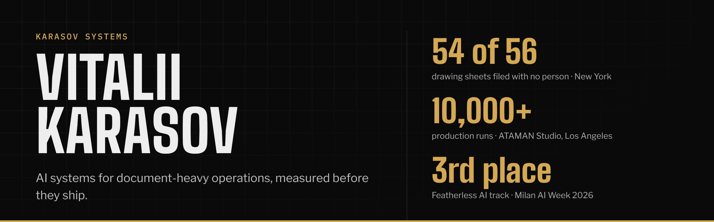

I take a messy, document-heavy process from the first client call to a system in production: scope, architecture, evaluation, code review, handover. Client work runs through Karasov Systems, with engineers working under my architecture and review.

**Open to** remote roles in AI deployment, forward deployed engineering and technical product management, and to fixed-scope client builds.

[karasov.co](https://karasov.co) · [LinkedIn](https://www.linkedin.com/in/vitaliikarasov/) · [Telegram](https://t.me/karvitalii)

### Client work

| | |
|---|---|
| **Architectural drawing intake** New York, 2026 | Reads drawing sets from email in five title-block formats, files every sheet as a new version, compares it with the last issue and marks the changes for each trade. 54 of 56 sheets filed with no person; 29 of 29 values it accepted alone were correct; $0.043 per scanned page; 552 tests at handover. [Case study](https://karasov.co/case-studies/architectural-drawing-intake-new-york) · [How it was measured](https://karasov.co/case-studies/drawing-intake-evaluation) |
| **ATAMAN Studio** Los Angeles, 2026 | Intake-to-contract system for a design-build studio: request qualification, consultation transcripts matched to the right client, proposal drafting by project type, contract detection. A person approves every outbound message. 10,000+ production runs. [Case study](https://karasov.co/case-studies/ataman-studio) |
| **International football academy** Spain, 2026 | CRM built from scratch with GDPR data work: contact lists merged and deduplicated, a legal basis recorded for every contact. [Case study](https://karasov.co/case-studies/crm-gdpr-data-setup-spain) |

### Open source

| | |
|---|---|
| **[SENTINEL](https://github.com/karasov-co/sentinel-audit)** | Adversarial multi-agent court for police bodycam footage. Prosecution, Defense and Judge agents run on different model families; every verdict points to an utterance and a video timestamp. Published evaluation report. 3rd place, Featherless AI track, AI Agent Olympics at Milan AI Week 2026. [Live demo](https://sentinel-audit.co) · [Evals](https://github.com/karasov-co/sentinel-audit/blob/main/docs/EVALS.md) |
| **[photo-ai-toolkit](https://github.com/karasov-co/photo-ai-toolkit)** | Culls a photo shoot into five piles and ranks every frame by what it becomes after a normal edit. Runs locally with no API key; a vision model adds the content read. |
| **[claude-code-delivery](https://github.com/karasov-co/claude-code-delivery)** | Five Claude Code slash commands for client delivery: scaffolding, code review, deploy checks, client reports, estimates. |
| **[domain-triage](https://github.com/karasov-co/domain-triage)** | Resumable pipeline that scores a CSV of domains on transparent rules, recommends an action for each and writes a readable report. 100 domains in about 20 seconds; a failed domain never stops the run. |

### How I measure

- Accuracy targets go into the scope before the build.
- Data used for tuning never counts toward the final numbers.
- The coding agent never sees the expected answer; it reports what it read and how sure it is.
- Below a confidence threshold, a person decides.

### Stack

Python · TypeScript · Next.js · FastAPI · Postgres and pgvector on Supabase · Claude API · LangGraph · MCP · Claude Code

For quick builds where they save the client time and budget: n8n, Make (Make Advanced certified), Zapier.

### Before AI

Five years running operations and projects, including a humanitarian organisation that handled personal data of vulnerable people under legal liability: 1.5M+ PLN budget, zero audit findings. MA in Project Management (Lazarski University, Warsaw), PRINCE2. Degrees in philosophy and history. Ukrainian, English, Polish, Russian.
